# Ajzak

Hobbystyczny, fanowski klon **The Binding of Isaac**, napisany w Unity przez trzech kumpli między sierpniem 2022 a lutym 2023.
Wrzucamy go jako ciekawostkę z przeszłości, a nie jako przykład dobrych praktyk. Uprzedzamy: kod bywa straszny.

> ⚠️ **To jest fan-game.** Nazwy przedmiotów, bossów, mechaniki i część grafik są wzięte z *The Binding of Isaac*
> (© Edmund McMillen / Nicalis). Projekt jest niekomercyjny i nie jest w żaden sposób powiązany z autorami oryginału.
> Szczegóły są w sekcji [Prawa autorskie](#prawa-autorskie).

## Gameplay

https://github.com/user-attachments/assets/6d8f120a-470c-436e-be1e-eb3fc379ea59

## Screenshoty

Zrzuty z buildu zrobionego w 2026 roku w Unity 6 (szczegóły w sekcji [Uruchomienie](#uruchomienie)).

| Menu | Pokój startowy z porozrzucanymi testowymi itemami |
|---|---|
| 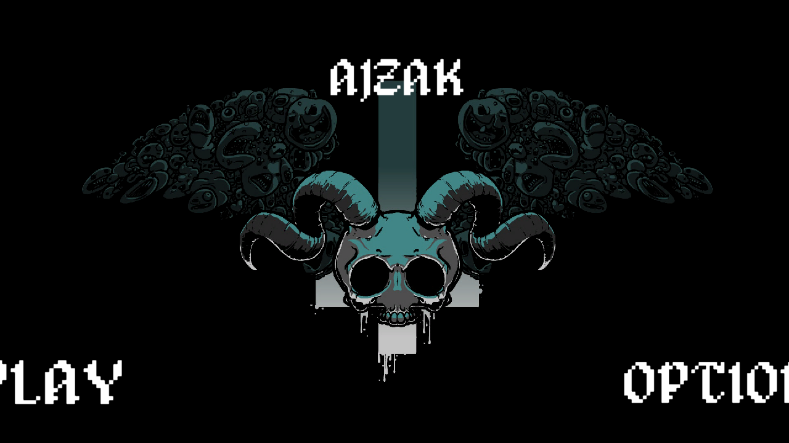 | 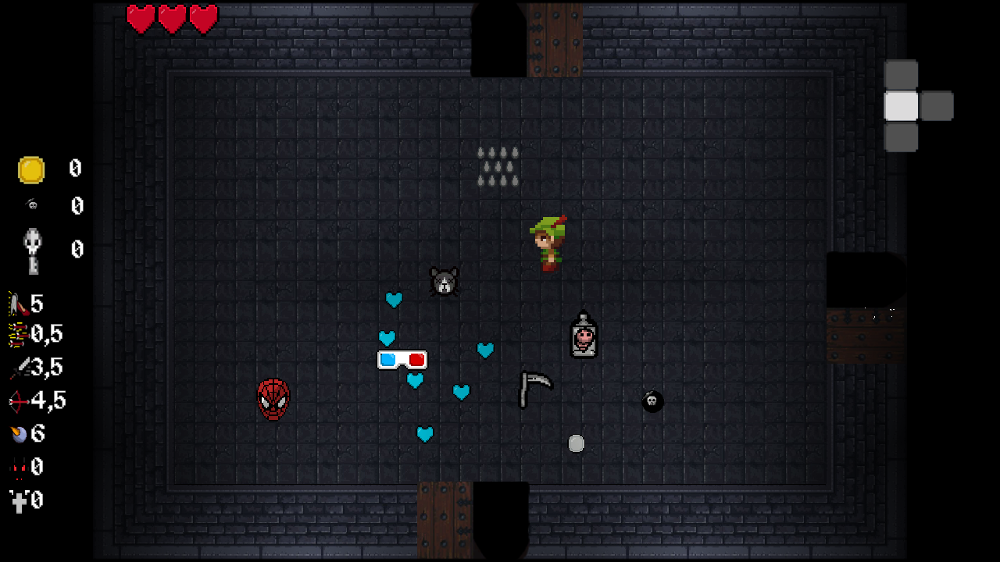 |
| **Po zebraniu itemów** (soul hearts, Guppy's Head na spacji) | **Walka**: łzy, pociski potwora, bomby |
| 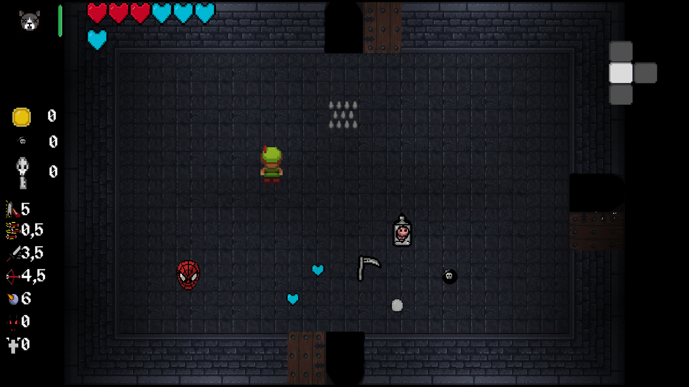 | 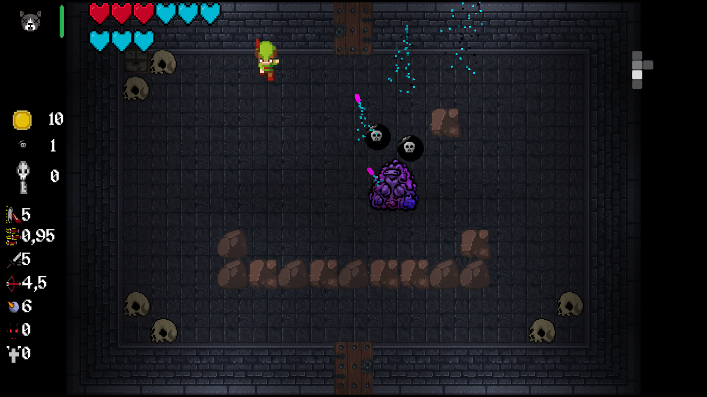 |
| **Bomby rozwalają kamienie** | |
| 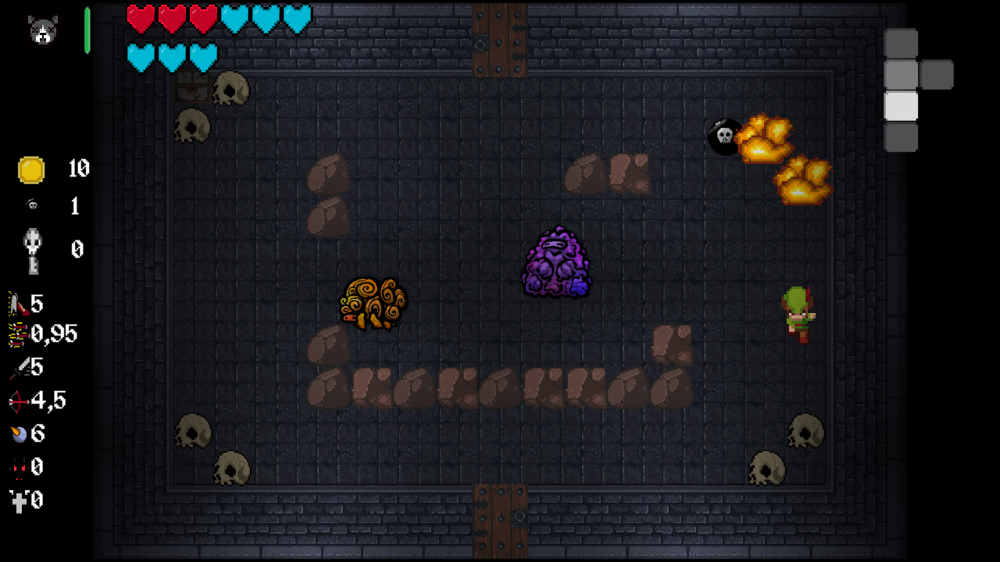 | |

## Co jest w środku

- **Proceduralnie generowany loch.** Mapa ma około 20 pokoi, a do tego pokój bossa (najdalej od startu), skarbiec, sklep i pokój przekleństwa.
- **Pokoje diabła i anioła** z szansą na pojawienie się, która spada, kiedy gracz oberwie u bossa.
- **Minimapa** z ikonami pokoi specjalnych i trybem pełnoekranowym.
- **System zdrowia** w stylu Isaaca: czerwone, pół-, soul, dark i eternal hearts.
- **Strzelanie łzami** w czterech kierunkach. Do tego lasery (Brimstone, Technology 2), ładowane strzały i nóż mamy.
- **Około 60 przedmiotów:**
  - statystyki: Speed Ball, Roid Rage, The Halo…
  - efekty łez: Spectral, Piercing, Ipecac, Rubber Cement, Proptosis…
  - familiary: Succubus, Dark Bum, Multidimensional Baby, Angelic Prism, Gemini…
  - przedmioty aktywne na spację: The Bible, Book of Belial, Necronomicon, Guppy's Head.
- **Bomby**, które niszczą kamienie, urny i pajęczyny. Można nimi też robić mosty nad dziurami.
- **Skrzynie, monety, klucze i baterie.**
- **Potwory:** muchy, szarżujący „taran”, strzelcy, Gipsis oraz Heniek, Maciek, Robert i Świnka Pipa.
- **Boss:** Duke of Flies.
- **Menu**, pauza pod ESC, ekran ładowania i muzyka.

## Generator lochu

### Jak to działa

1. **Pokój startowy** (`Destroyer.cs`) losuje, z których ścian wyrosną kolejne pokoje: `Random.Range(2, 4)`, czyli zawsze 2 albo 3 drzwi, nigdy 4. Na pozostałych ścianach włącza „Destroyery”, czyli ściany bez drzwi.
2. **Spawner** (`spawnery.cs`) stawia w swoim miejscu nowy pokój i losuje mu przynajmniej jedno wyjście. Jeśli trafi na istniejący pokój albo Destroyera, po prostu się usuwa: kolizje 2D załatwiają to, żeby pokoje na siebie nie wchodziły.
3. **Dopychanie do `MinRooms`** (`RoomsPrefabs.RoomBooster`). Dopóki pokoi jest za mało, co klatkę losowany jest istniejący pokój, a jeden z jego Destroyerów zamienia się w spawner. Tak loch rozrasta się na boki.
4. **Klasyfikacja po liczbie drzwi** (`cetral.cs`). Każdy pokój przez pierwsze 5 sekund liczy swoje drzwi i zapisuje się do listy `Rooms1`…`Rooms4`. `Rooms1` to ślepe zaułki.
5. **Pokoje specjalne trafiają tylko do ślepych zaułków**, tak jak w Isaacu:
   - boss ląduje w zaułku **najdalej od startu**;
   - skarbiec, sklep i pokój przeklęty trafiają do losowych zaułków;
   - jeśli zaułków jest za mało, generator podbija `MinRooms` i rośnie dalej.
6. Każdy zwykły pokój dostaje losowy układ kamieni i potworów z `ConfigurationRooms`. Po sekundzie przebudowuje się NavMesh dla AI.

### Jak to wygląda

Generator jest pomyślany pod **małe piętra**: domyślnie 20 pokoi plus pokój startowy.

Obrazy pochodzą z debugowego podglądu mapy, dodanego na potrzeby tego README tylko w lokalnej kopii (nie ma go w repo). Kamera obejmuje całe piętro. W trybie schematu każdy pokój jest prostokątem w kolorze swojego typu, a szare łączniki to faktyczne drzwi między pokojami.

Tak piętro powstaje (całość trwa ok. 1–2 sekundy, tu spowolnione):

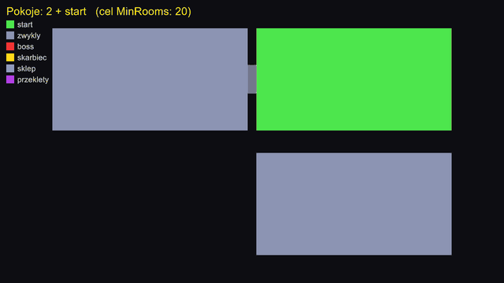

Ta sama mapa z teksturami i jako schemat:

| Piętro 1 (tekstury) | Piętro 1 (schemat) |
|---|---|
| 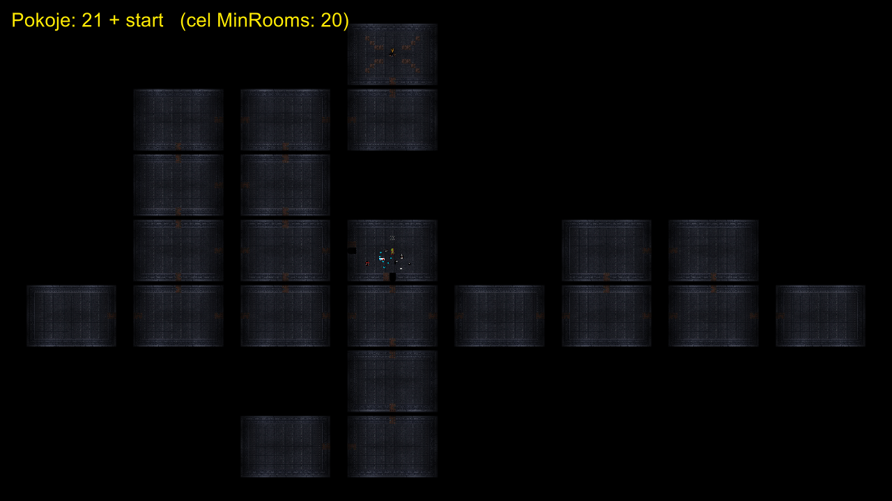 | 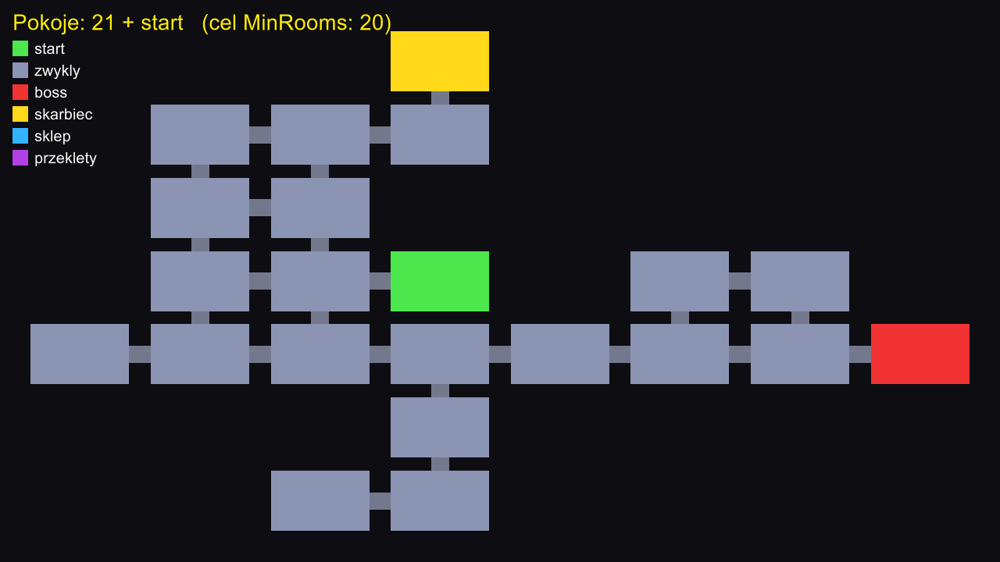 |
| **Piętro 2 (tekstury)** | **Piętro 2 (schemat)** |
| 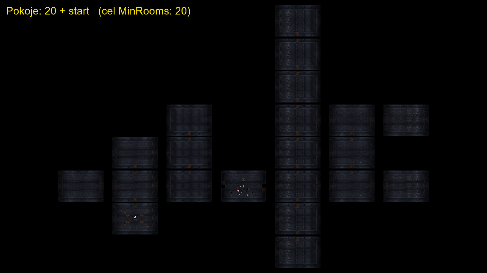 | 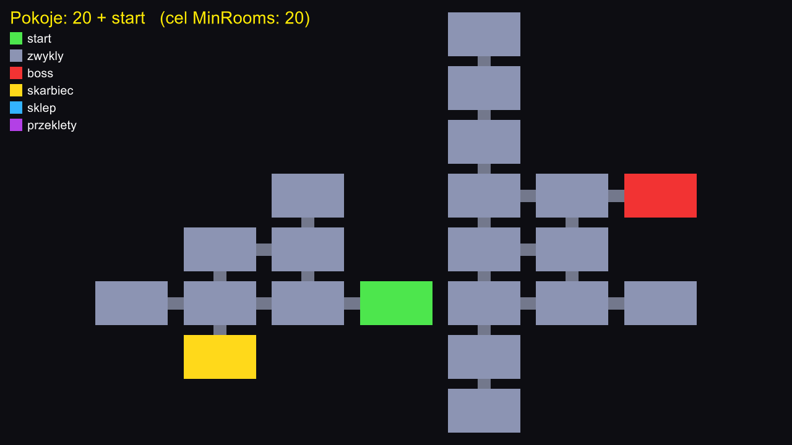 |

Dwa kolejne losowe piętra:

| Piętro 3 | Piętro 4 |
|---|---|
| 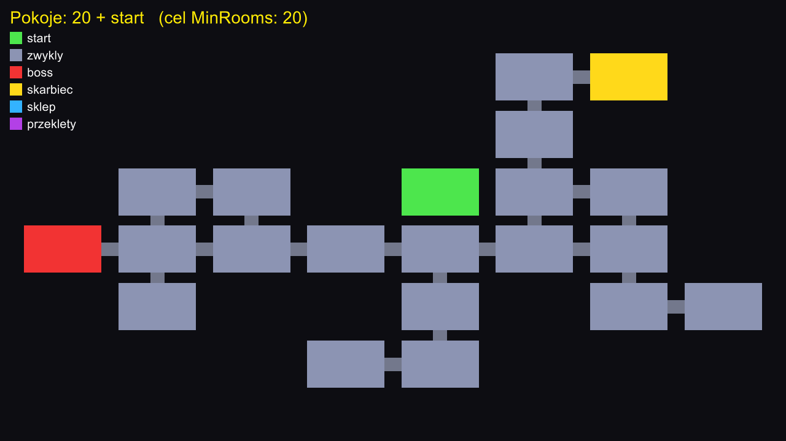 | 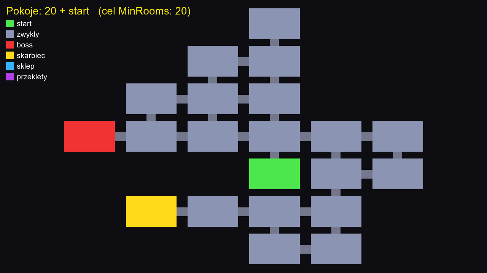 |

### Obserwacje

- **Kształt pięter.** Każde piętro wygląda inaczej: raz zwarty kleks, raz długi korytarz z odnogami. Boss zawsze siedzi w ślepym zaułku najdalej od startu, a skarbiec w innym zaułku.
- **Pokój startowy nie jest na liście `Rooms`.** Jako jedyny nie ma skryptu `AddRooms`, więc nie liczy się do `MinRooms`. Licznik „20 + start” to właśnie to.
- **Spawnery wywołują się lawinowo.** Każdy spawner co klatkę odpala `Invoke("Spawn", 0.1f)`, więc oczekujące wywołania się piętrzą. Przy 20 pokojach nie ma to znaczenia, ale robi się z tego niepotrzebna praca.
- **Pierwsze piętro ma tylko bossa i skarbiec.** W scenie zapisane jest `_specialRoomsToSpawn: 1`, a `Random.Range(0, 1)` zawsze dodaje jeszcze jeden pokój. Sklep dochodzi od kolejnego piętra, bo `Trapdoor` ustawia licznik na 3.

## Kto za co odpowiadał

Podział na podstawie historii gita (`git blame` na obecnych skryptach i autorzy commitów z grafikami).
Łącznie jest około 620 commitów i około 11,8 tys. linii naszego C#.

| Kto | Linie C# (blame) | Za co odpowiadał |
|---|---|---|
| **[Boc7777](https://github.com/Boc7777)** | ~4,1 tys. | **Generowanie lochu i pokoi:** `room/`, `RoomsPrefabs`, `AddRooms`, `cetral`, `Destroyer`, spawnery. Do tego minimapa, pokoje diabła i anioła, sklep, trapdoor, NavMesh dla potworów, bazowe AI potworów (`Monster`, `taran`, `Gipsis`, `shooters`), menu, ekran ładowania, system audio. Wstępna wersja systemu serduszek. Ściągał i składał tilesety (podłogi, ściany, Tiny RPG Forest). |
| **[majpokx](https://github.com/majpokx)** | ~5,9 tys. | **Strzelanie i przedmioty.** Cały system łez (`arrows`, `PlayerShooting`, `TearsCreator`), lasery i Brimstone, ładowane strzały, Mom's Knife, prawie wszystkie około 60 itemów (statystyki, efekty, familiary, Zodiac, przedmioty na spację), `PlayerStats`, `PlayerItems`, `SpaceBar`, przyjazne muchy, otrzymywanie obrażeń przez potwory. Część sprite'ów itemów i UI paska spacji. |
| **[MikPacz](https://github.com/MikPacz)** | ~1,8 tys. | **Bomby, kamienie, mosty, skrzynie i pickupy** (`BombThings/`, `ChestsAndPickups/`). Boss Duke of Flies. Najwięcej **pixel artu**: sprite'y przedmiotów, serduszka, monety i bomby, eksplozje, muchy, Duke. Do tego czcionki i animacja bomby. |

## Co działa nawet spoko

- **Generowanie lochu naprawdę działa.** Pokoje się dobudowują, boss ląduje najdalej od startu, a pokoje specjalne nie nachodzą na siebie. Jak na pierwszy proceduralny generator robi robotę.
- **Ilość zawartości.** Około 60 przedmiotów, które ze sobą współgrają (Spectral + Piercing + Rubber Cement na jednej łzie). Jak na hobbystyczny projekt to sporo.
- **Ładne rzeczy w kodzie:** `EventManager` na statycznych eventach `Action`, `ItemManager` z pulami przedmiotów, które się nie powtarzają, `audioManager` z tablicą `Sound[]` i NavMeshPlus do pathfindingu potworów w 2D.
- **Własny pixel art.** Większość sprite'ów przedmiotów i UI to ręcznie rysowane przeróbki, a nie zgrane pliki z gry.
- **Organizacja folderów** (`items/Stats`, `items/Familiar`, `items/Shoot`…) jest całkiem czytelna.

## Co zostało kompletnie spartolone

- **Gra nigdy nie dała się zbudować do exe.** W 8 skryptach zostały auto-importy z Visual Studio, np. `using static UnityEditor.Experimental.GraphView.GraphView;` w `player_movement.cs`. `UnityEditor` nie istnieje poza edytorem, więc build kończy się błędami kompilacji i gra działała tylko w Play Mode.
- **`GameObject.Find` / `transform.Find("Spawnery/...")` wszędzie.** To około 650 wywołań po stringach, część w `Update()`. Wystarczy zmienić nazwę obiektu w hierarchii i gra się sypie.
- **Generator oparty na timerach i kolizjach.** `RoomsPrefabs.Update()` co klatkę sprawdza `_timer > 1f`, `_timer > 2f`, a jak pokoi specjalnych brakuje, to po prostu robi `MinRooms++`. Wynik zależy od FPS-ów i nie ma seeda, więc nie da się odtworzyć mapy.
- **`PlayerHealth` (875 linii).** Serduszka trzymane są jako `int[12]` z magicznymi liczbami (`40/41/42` dla czerwonych, `51/52` dla soul…). Logika „przesuń serca w tablicy” jest skopiowana kilka razy, a `_serca[i + 1]` przy `i == 11` może wyjść poza tablicę.
- **Architektura przedmiotów.** `arrows.cs` (520 linii) to god-object: każdy nowy przedmiot oznacza nowy `bool` w łzie, a łza sama sprawdza wszystkie efekty. Do tego każdy przedmiot to osobny skrypt kopiuj-wklej (`Find("Player")`, `OnTriggerEnter2D`, `stat += x`). Aż prosi się o ScriptableObject.
- **UI menu nie jest skalowane.** Canvas jest w trybie „Constant Pixel Size”, więc przy innej rozdzielczości niż ta, w której go układano, napisy „PLAY” i „OPTIONS” wyjeżdżają poza ekran.

## Uruchomienie

- ⚠️ **W tym repo nie ma grafik ani czcionek** (szczegóły w sekcji [Prawa autorskie](#prawa-autorskie)). Projekt się otworzy i kod się skompiluje, ale sprite'y będą puste, a teksty bez czcionek.
- Unity **2021.3.19f1** (LTS), URP 2D.
- Otwórz folder w Unity Hub i odpal scenę `Assets/Scenes/Menu.unity` w Play Mode.
- **Build do exe nie przejdzie bez poprawek.** Trzeba usunąć `using UnityEditor...` z 8 skryptów (opis w sekcji wyżej).
- **Pod Unity 6 (6000.0)** dodatkowo trzeba:
  - usunąć `TextMesh Pro/Examples & Extras`, bo się nie kompiluje;
  - wymienić `com.unity.feature.2d` na pojedyncze pakiety 2D bez `pixel-perfect`;
  - podmienić shadery w `Assets/TextMesh Pro/Shaders` na nowe z *TMP Essential Resources*. Inaczej tekst renderuje się jako białe prostokąty.
- Sterowanie: WASD to ruch, strzałki to strzał, `E` to bomba, spacja to przedmiot aktywny, TAB to pełna minimapa, ESC to pauza.

## Prawa autorskie

To niekomercyjny fan-game inspirowany *The Binding of Isaac* (© Edmund McMillen / Nicalis). Nie jest w żaden sposób powiązany z autorami oryginału. Nazwy przedmiotów i bossów pochodzą z oryginalnej gry.

W repozytorium jest tylko nasz kod i nasza muzyka. Grafiki i czcionki zostały usunięte, bo część z nich nie jest nasza. Dlatego po otwarciu w Unity sprite'y są puste. Screeny i film powyżej pochodzą z naszej prywatnej kopii z pełną grafiką.
