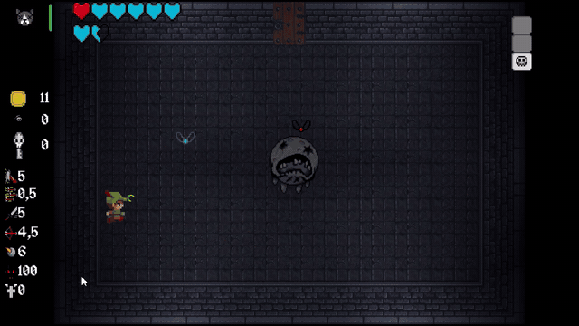

# Ajzak

Roguelike typu twin-stick shooter zrobiony w **Unity**, inspirowany grą *The Binding of Isaac*.
Projekt fanowski / hobbystyczny, niekomercyjny.

## Screeny

| | |
|---|---|
|  |  |
|  |  |

## Co jest zaimplementowane

- Generowanie układu pokoi i przejścia między nimi
- Minimapa z oznaczeniem odwiedzonych pokoi, sklepu, bossa i pokoju specjalnego
- Ok. 60 przedmiotów z efektami: statystyki, nowe rodzaje strzałów (laser, nóż, ładowany atak), efekty łez (przebicie, trucizna, spectral), przedmioty aktywne
- Familiary podążające za graczem
- Przeciwnicy z AI (NavMeshPlus) oraz boss
- Bomby, klucze, monety, skrzynie, sklep
- System zdrowia z różnymi rodzajami serc
- Menu główne
- Własna muzyka i efekty dźwiękowe

## Technologie

- Unity 2021.3.19f1
- C#
- [NavMeshPlus](https://github.com/h8man/NavMeshPlus) – nawigacja przeciwników w 2D
- TextMesh Pro

## Struktura

- `Assets/scripts` – cały kod gry (gracz, przedmioty, potwory, pokoje, minimapa, menu)
- `Assets/Prefabs`, `Assets/Rooms` – prefaby i szablony pokoi
- `Assets/Scenes` – sceny (`Menu`, `SampleScene`)

## Uwaga o grafice

Grafiki i fonty zostały **usunięte z tego repozytorium**, ponieważ część z nich
pochodzi z *The Binding of Isaac* lub z paczek assetów, których licencje nie pozwalają na
publiczną redystrybucję. Dlatego projekt po otwarciu w Unity nie będzie miał tekstur.
Repozytorium służy do pokazania kodu.

*The Binding of Isaac* i powiązane znaki należą do ich właścicieli. Ten projekt nie jest z nimi powiązany.
